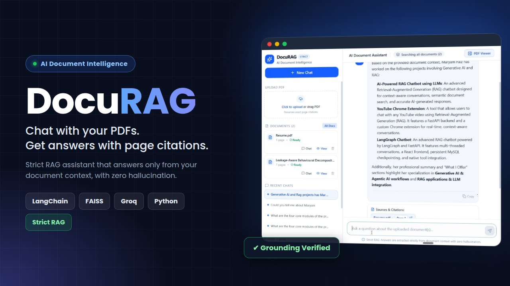

<div align="center">



# DocuRAG

**Chat with your PDFs. Get answers with exact page citations.**

A Retrieval-Augmented Generation (RAG) assistant that answers *strictly* from your uploaded documents, with clickable page-level sources and a built-in PDF viewer.


</div>

---

## 📖 Overview

DocuRAG is a full-stack document Q&A system built with **FastAPI**, **FAISS**, **HuggingFace Sentence-Transformers** and the **Groq** LLM API, with a modern **React + Tailwind** three-panel interface (Sidebar, AI Chat, PDF Viewer).

Its core design principle is **strict factual grounding**: the model may only use the retrieved document chunks. If the answer is not in your PDF, it says so instead of inventing one.

> *"I could not find this information in the uploaded document."*

---

## 🌟 Key Features

- **Strict grounding (no hallucination):** a strict system prompt and `temperature = 0` keep answers tied to retrieved text only.
- **Page-level citations:** every answer shows tags like `📄 Annual_Financial_Report_2024.pdf • Page 1 ↗`. Click one and the PDF viewer jumps to that exact document and page.
- **Three-panel UI:**
  - **Sidebar:** drag & drop PDF upload, document cards (page count, Chat / View / Delete), recent chats, vector store status.
  - **Chat:** scope selector (all documents or one PDF), streaming Markdown answers, copy button, and a collapsible *View Retrieved Context* section showing FAISS chunks with similarity scores.
  - **PDF Viewer:** zoom, previous/next page, direct page jump, synced with citation clicks.
- **Multi-document search:** ask across all uploaded PDFs or restrict to a single one.
- **Multi-turn memory:** follow-up questions are rewritten into standalone search queries, and the last few turns are passed to the LLM.
- **Persistent history:** chats, documents and the FAISS index are saved on disk.
- **Streaming responses** via Server-Sent Events (SSE).

---

## 🏗️ Architecture

```text
┌─────────────────────────┐     ┌────────────────────────┐     ┌────────────────────────┐
│     React + Vite        │◄───►│    FastAPI Backend     │◄───►│   FAISS Vector Store   │
│  (Tailwind, Lucide UI)  │     │  (Chunking & Routing)  │     │   (all-MiniLM-L6-v2)   │
└─────────────────────────┘     └───────────┬────────────┘     └────────────────────────┘
                                            │
                                            ▼
                                  ┌───────────────────┐
                                  │     Groq LLM      │
                                  └───────────────────┘
```

### RAG pipeline

1. **Upload:** PDF is saved and text is extracted page by page (PyPDF), keeping 1-indexed page numbers.
2. **Chunk:** each page is split into overlapping chunks (default 600 / 100 overlap) with document and page metadata.
3. **Embed:** chunks are embedded with `all-MiniLM-L6-v2` (384-dim) and stored in FAISS (`IndexFlatIP` with normalized vectors, i.e. cosine similarity).
4. **Retrieve:** the question is (if it is a follow-up) rewritten into a standalone query, then the top 5 chunks above a similarity threshold are fetched.
5. **Generate:** Groq answers using only those chunks; sources are attached as page citations.

---

## 🛠️ Tech Stack

| Layer | Technology |
|-------|------------|
| Frontend | React 19, Vite, Tailwind CSS, Lucide Icons, Framer Motion, React Markdown, pdf.js |
| Backend | FastAPI, Uvicorn, Pydantic, Python-Multipart |
| Vector DB | FAISS (`faiss-cpu`) |
| Embeddings | `sentence-transformers/all-MiniLM-L6-v2` |
| LLM | Groq Cloud (model set via `GROQ_MODEL`) |
| PDF parsing | PyPDF (page-aware extraction) |

---

## 🚀 Getting Started

### Prerequisites

- Python **3.10+**
- Node.js **18+** and npm
- A free [Groq API key](https://console.groq.com/)

### 1. Clone the repository

```bash
git clone https://github.com/GenerativeAiWithMariams/Rag_With_Page_Citation.git
cd Rag_With_Page_Citation
```

### 2. Backend setup (FastAPI)

```bash
cd backend

# Create and activate a virtual environment
python -m venv venv
source venv/bin/activate          # Linux / macOS
venv\Scripts\activate             # Windows

# Install dependencies
pip install -r requirements.txt

# Configure environment variables
cp .env.example .env              # Windows: copy .env.example .env
```

Open `backend/.env` and add your key:

```env
GROQ_API_KEY=your_groq_api_key_here
GROQ_MODEL=llama-3.3-70b-versatile
EMBEDDING_MODEL_NAME=sentence-transformers/all-MiniLM-L6-v2
CHUNK_SIZE=600
CHUNK_OVERLAP=100
```

Start the server:

```bash
python -m uvicorn app.main:app --host 127.0.0.1 --port 8000 --reload
```

- API: `http://127.0.0.1:8000`
- Swagger docs: `http://127.0.0.1:8000/docs`
- Health check: `http://127.0.0.1:8000/api/health`

> ⚠️ The first run downloads the embedding model, so it may take a minute.

### 3. Frontend setup (React + Vite)

Open a second terminal:

```bash
cd frontend
npm install
npm run dev
```

The app runs at **http://localhost:5173** and proxies `/api` requests to the backend on port 8000.

---

## 🧪 Testing the RAG Pipeline

An automated script validates PDF extraction, FAISS indexing, multi-turn memory, no-hallucination grounding and cross-document retrieval using the two sample PDFs in `backend/sample_docs/`:

```bash
cd backend
python test_rag.py
```

---

## 🔌 API Endpoints

| Method | Endpoint | Description |
|--------|----------|-------------|
| `GET` | `/api/health` | Service status, model names, vector count |
| `POST` | `/api/documents/upload` | Upload and index one or more PDFs |
| `GET` | `/api/documents` | List indexed documents |
| `GET` | `/api/documents/{id}/file` | Serve the PDF for the viewer |
| `DELETE` | `/api/documents/{id}` | Delete a PDF and its vectors |
| `POST` | `/api/chat` | RAG answer (non-streaming) |
| `POST` | `/api/chat/stream` | RAG answer streamed via SSE |
| `GET` | `/api/chat/conversations` | List saved conversations |
| `GET` | `/api/chat/conversations/{id}` | Get a full conversation |
| `DELETE` | `/api/chat/conversations/{id}` | Delete a conversation |

---

## 📁 Project Structure

```text
Rag_With_Page_Citation/
├── backend/
│   ├── app/
│   │   ├── main.py                  # FastAPI entry point & CORS
│   │   ├── config.py                # Environment & path config
│   │   ├── api/
│   │   │   ├── documents.py         # Upload, list, serve, delete PDFs
│   │   │   └── chat.py              # Chat, streaming, history
│   │   ├── services/
│   │   │   ├── pdf_service.py       # Page-aware extraction & chunking
│   │   │   ├── embedding_service.py # Sentence-Transformers embeddings
│   │   │   ├── vector_store.py      # FAISS persistence & search
│   │   │   ├── llm_service.py       # Groq client with strict prompt
│   │   │   └── rag_service.py       # Query rewrite, retrieval, citations
│   │   └── schemas/schemas.py       # Pydantic models
│   ├── sample_docs/                 # Sample PDFs for testing
│   ├── test_rag.py                  # Automated RAG test script
│   ├── create_sample_pdf.py         # Sample PDF generator
│   ├── requirements.txt
│   └── .env.example
├── frontend/
│   ├── src/
│   │   ├── components/
│   │   │   ├── Sidebar.jsx          # Upload, documents, recent chats
│   │   │   ├── ChatArea.jsx         # Chat & citations
│   │   │   └── PDFViewer.jsx        # Integrated PDF viewer
│   │   ├── services/api.js          # REST API client
│   │   ├── App.jsx                  # Three-panel layout & state
│   │   └── index.css
│   ├── package.json
│   └── vite.config.js               # Dev server & API proxy
├── DocuRAG_thumbnail.jpg
└── README.md
```

> Runtime data (uploads, FAISS index, chats) is stored in `backend/data/`, which is git-ignored.

---

## 🔐 Security Notes

- Never commit your `.env` file. It is already listed in `.gitignore`.
- CORS is currently open (`*`) for local development. Restrict `allow_origins` before deploying publicly.

---

## 🔮 Future Improvements

- User authentication and per-user document spaces
- OCR support for scanned PDFs
- Support for DOCX / TXT / web pages
- Hybrid search (BM25 + vectors) and re-ranking
- Docker setup for one-command deployment

---

## 👩‍💻 Author

**Maryam**, AI Engineer (RAG, Agentic AI, LangChain, Python)
GitHub: [GenerativeAiWithMariams](https://github.com/GenerativeAiWithMariams)

---

<div align="center">⭐ If you found this project useful, please consider giving it a star!</div>
